# Release app-v0.4.0

Everything merged into `staging` since the last release (#778, app-v0.3.0, which took staging as it was at #682) goes to `main`: 156 pull requests, #684 to #846. The owner's test of the contributor app (APK run 42485212627) passed all six checks, swipe-away included.

Tested at staging's head, `beb25dfb` (#844):

- **CI on that commit:** all 33 jobs passed on their first attempt, so no known flake needed a re-run. That covers every browser suite: the drawing suites, the editor, commuter-test in three parts, phone-test, where-test, loop-test, pwa-test with both basemaps, the contributor suites (contribute, upload, offline, handover, profile, claim, account, forgot-password), the studio suites, scale-test and turnstile-test. CodeQL and Security passed too.
- **`npm run check` locally:** passes. That is formatting, lint, the build with its guards, and 1,705 unit checks with 0 failing.

## What changed on screen

### Commuter map

The route cards are the owner's new design: route card redesign steps 1–11, and the README in `.scratch/route-card-redesign/` has the decisions.

- **Route cards** (#779–#781, #786, #821, #822, #833): each card wears its mode's colour (Jeep blue, UV Express grey, E-Jeep near-white, Bus orange), with its mode at the top. Trains and the ferry keep their own looks.
- **The route list:**
  - One card per place and mode, grouped by mode (#786).
  - The Controller holds ✕, switch and a filter by mode (#788).
  - The filter lights the matching routes on the map (#812).
- **Sheets** (#794, #832):
  - On a wide screen the route list is docked on the left.
  - On a phone every sheet opens at Low and can be dragged freely up to full height.
  - Only Low pulls the sheet in. A flick down goes to Low, and from Low it closes.
  - The handle steps a third at a time.
  - At Low, a tap raises the sheet before anything under it can be picked.
- **Route lines** (#700, #818, #828):
  - At rest, every line is one pale colour with no rim.
  - A lit line wears its mode's colour on a dark (neutral-800) casing.
  - The arrows along a line pause while the map is out of sight (#797).
- **Hotspots** (#684, #697, #813, #827): each hotspot keeps its dot when zoomed out. The pins are off on the commuter map, behind one switch.
- **Place search** (#817, #829, #831, #836, #840):
  - Search Para's own places, plus OpenStreetMap landmarks and the routes near them.
  - A search that lands on a landmark drops a pin there.
- **Basemap** (#765): the monochrome basemap leans greyish violet.
- **Messages:**
  - At full sheet height, the location problem message sits under the card's ✕, so the ✕ stays in reach (#835).
  - Render errors are caught, so one failure doesn't blank the page (#693).

### Studio

- **Signing in** (#714, #716, #760):
  - The sign-in card is the owner's Figma design.
  - The sign-in and password panels are real modal dialogs.
  - Their messages say what happened, never Supabase's own wording.
- **Drawing** (#698, #701, #707, #709, #712, #717–#720, #724–#730, #734–#737, #741, #743, #744, #759):
  - The line is drawn in the brand colour, with arrows, and the drawing toolbar uses the owner's own icons.
  - Tools: Move, Snap (with a live dashed preview) and Draw (a pen with curves and handles).
  - A loop closes by clicking its first point.
  - Redo, Figma's keys and Figma's mouse wheel all work, with zoom eased.
- **Drafts and publishing** (#695, #696, #699, #703, #704, #710, #718, #742, #745, #748, #750, #768):
  - Editing a route or hotspot opens the editor's own draft.
  - Only a draft's maker can discard it.
  - A draft tapped on the map opens straight into editing.
  - Draft and Published replace the old review steps.
- **The route's sidebar** (#708, #726, #749, #751, #753–#758, #774, #777):
  - On a computer it stands left of the map, with Route Information, the Route line, Line detail (author and dates), terminals and hintuans, and Published with Exit and Unpublish.
  - A tapped hotspot opens there too.
- **Also in the studio:**
  - The route list's filter, as on the commuter map (#815).
  - Place search on the workshop and the Contributors map (#830).
  - The map's ⓘ at the lower left (#731).
  - Drafts in the top bar (#757).

### Contributor app

- **Recording:**
  - Keeps recording after the app is swiped away from Recents (#793, #798, #841).
  - A ride still recorded by the service reopens on the recording screen (#825).
  - The loading page no longer ends a live ride (#845).
  - A ride that has ended leaves no notification (#845).
- **Battery:**
  - "Keep Para recording", the upgraded battery card (#807).
  - Android's battery dialog at the first Start, and the card names "No restrictions" (#844).
- **Location:**
  - No ride starts while the phone's location is off (#803).
  - The locate button turns location on, or says it's off (#787, #800).
  - The last known place stays on the map, greyed, with how long ago (#804).
- **No signal:**
  - The map loads with no signal and keeps the map pieces the phone has seen (#789, #790).
  - It reloads once the phone is back online (#784).
  - Every map style switches with no signal (#805).
  - A load with no answer gives way to "Try again" after 8 s (#806).
- **The map** reads the published routes and hotspots from the public site (#842).
- **History** says what each ride became (#810). Stop on a ride left open wears Finish's flag (#843).
- **Deleting an account** never deletes the uploads (#692, #747).

## Screenshots

Taken on this release's code with the dev server. The studio ran against the test suites' in-memory stand-in, so no live data was involved. Phone shots are 393 wide; computer shots are 1440.

### Commuter map

| | |
| --- | --- |
| 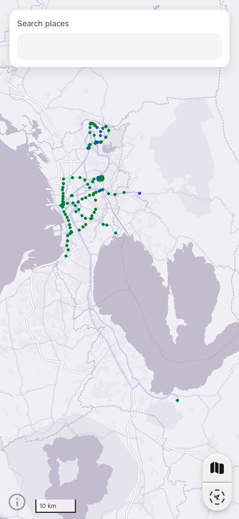 | 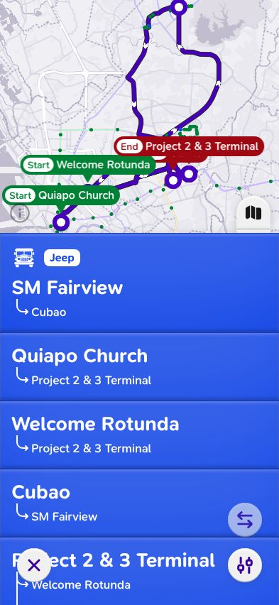 |
| The map at rest: every route line one pale colour | A shared road tapped: the route list, raised a third, with the Controller |
| 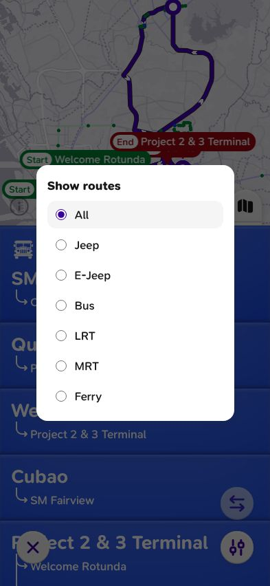 | 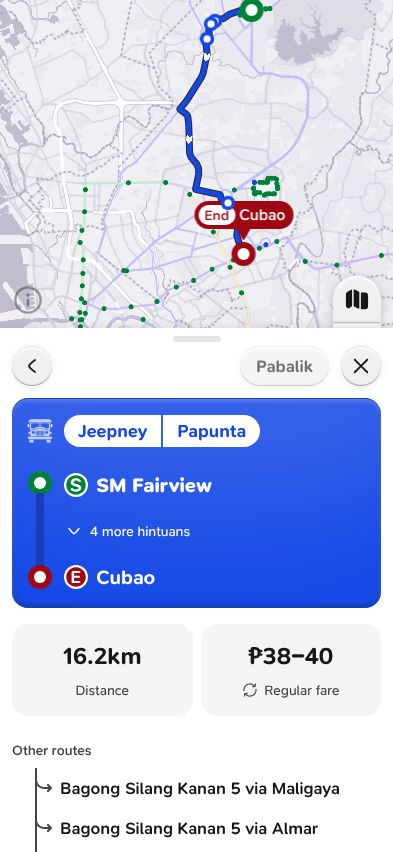 |
| The filter: one mode, or All | A trip: its line lit on the dark casing, the timeline and the fare |
| 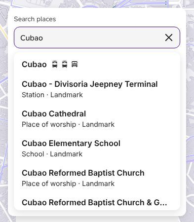 | |
| Place search: Para's places and OpenStreetMap landmarks | |

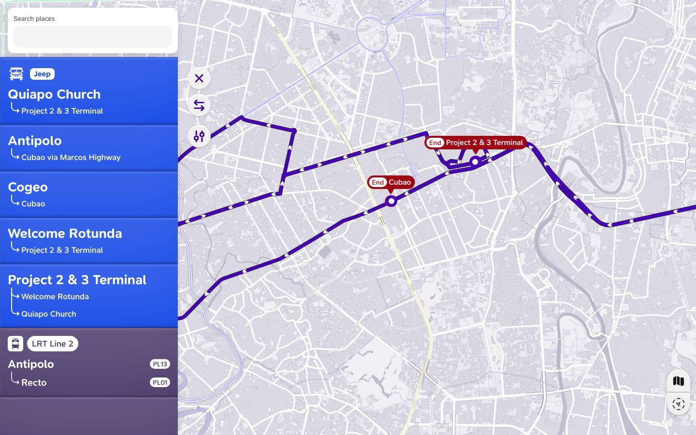

On a computer the route list is docked on the left, with the Controller beside it.

### Studio

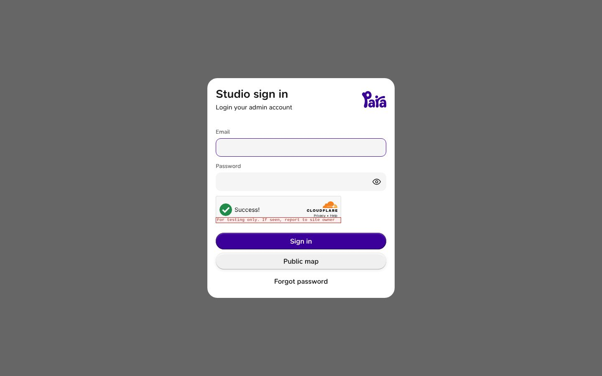

The sign-in card, from the owner's Figma.

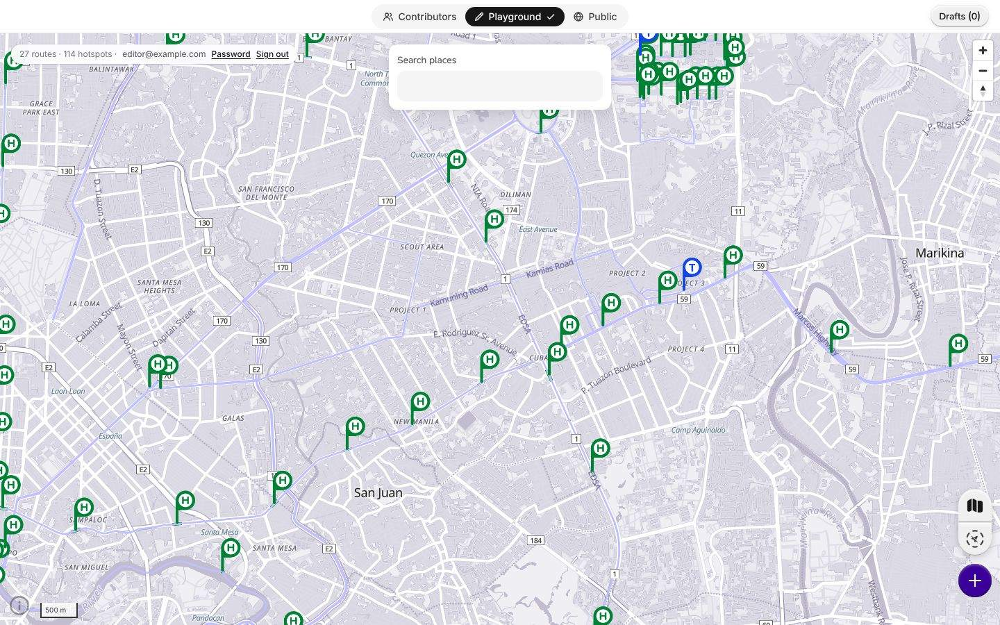

The workshop, signed in: Contributors, Playground and Public, with Drafts in the top bar.

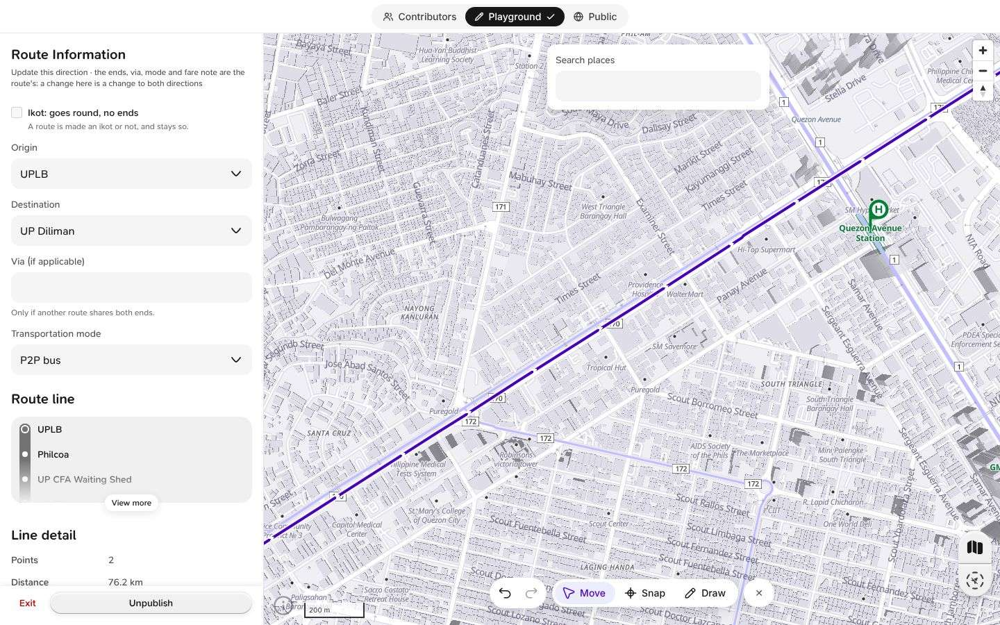

A route open for editing: its sidebar on the left and the Move · Snap · Draw toolbar.

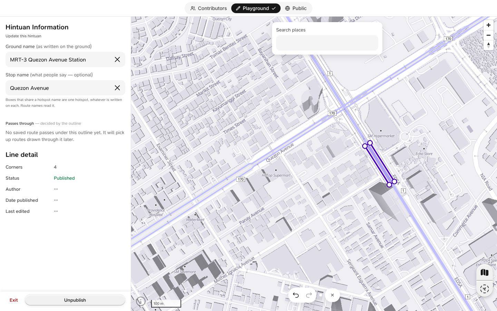

A hotspot open in the sidebar, with Exit and Unpublish.

### Contributor app

| | | |
| --- | --- | --- |
| 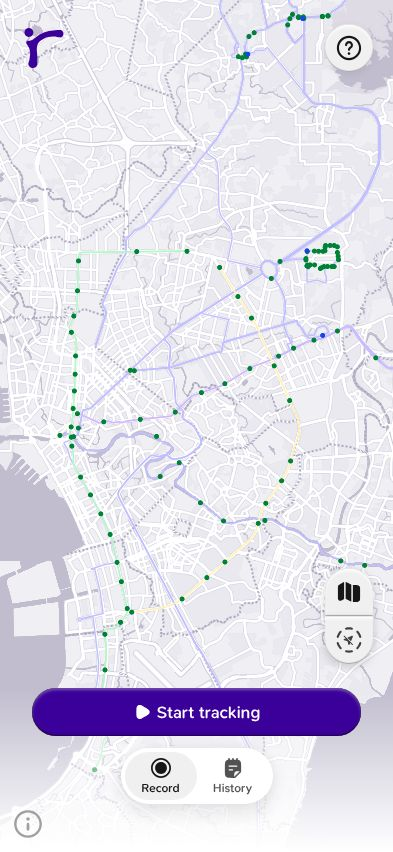 | 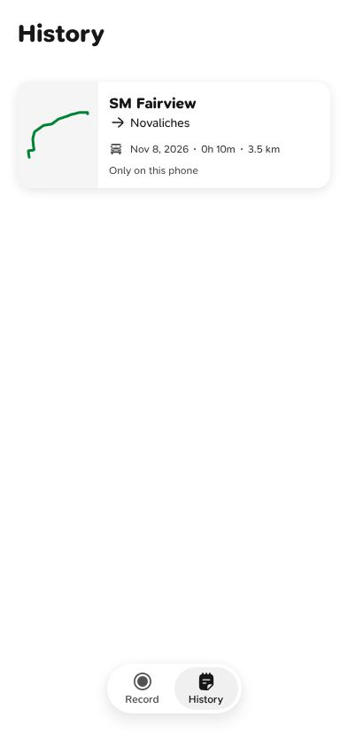 | 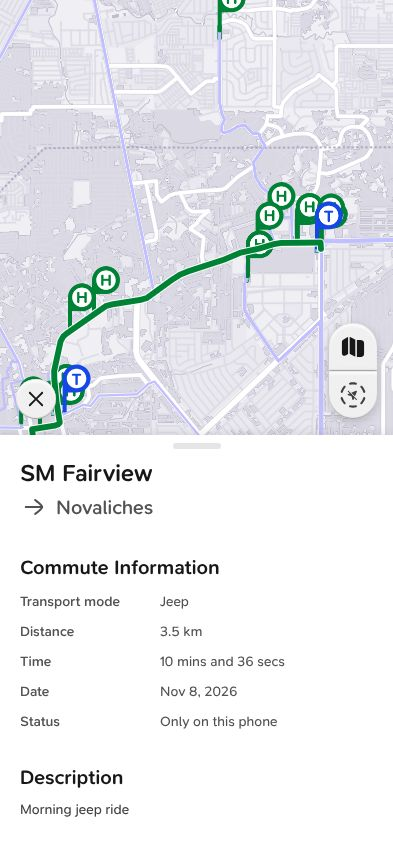 |
| The first screen: the map, then Start tracking | History: what each ride became | A ride's detail: its trail on the map |

## Database

Every migration in this release was applied live by the owner before its PR merged. None needs applying on release, and no workflow applies migrations when `main` changes. The table in `supabase/migrations/README.md` records each one:

- review rules (#728);
- a draft whose maker is gone can be edited by any editor (#732);
- Draft and Published (#745);
- deleting a user keeps their uploads (#747);
- the map tables locked to the draft functions (#770, applied 2026-11-06);
- unused tables and columns dropped (#772, applied 2026-11-06).

#770's and #772's titles still say "not applied", but both were applied live on 2026-11-06 before they merged.

## Size

`npm run build`, then `scripts/checks/health.mjs`, on `main` (app-v0.3.0) and on this release:

| | main (0.3.0) | this release | budget |
| --- | --- | --- | --- |
| MapLibre, React and the shared code together | 410.9 kB | **407.0 kB** | 413 kB (412 on main; raised by #693) |
| maplibre chunk | 137.4 kB | 137.3 kB | 160 kB |
| maplibre-gl-shared chunk | 134.8 kB | 134.8 kB | 160 kB |
| react chunk | 57.6 kB | 57.6 kB | 70 kB |
| shared chunk | 71.0 kB | 67.1 kB | 80 kB |
| zod chunk | 10.2 kB | 10.2 kB | 11 kB |
| MapLibre's worker | 5.9 kB | 5.8 kB | 20 kB |
| fonts (not gzipped) | 106.7 kB | 106.7 kB | 135 kB |
| The contributor page's own code | 30.8 kB | **31.0 kB** | under 31 kB |

The route icons moved into a sprite the page fetches (#791), which freed room for the redesign.

## Known issues

- **Story plays:** 59 Storybook plays fail, and they fail the same way on the build from before the route card redesign. CI doesn't run plays, so they don't show as red there. They are:
  - the contributor screens' focus plays (26);
  - the map style control (11);
  - the hotspot pins (6);
  - the route line labels (3);
  - some studio forms (10);
  - the toast host (3).
- **Contributor page budget:** its own code is 31.0 kB against "under 31 kB": it passes, at the line. The next contributor feature needs room made first.
- **Place search, to check:** in headless Chromium a flat grey block showed on the map under the search results, as wide as the search card (the screenshot above is cropped above it). It is drawn in the map's canvas and came back every time. It is not yet known whether a real phone shows it, so it is one for the place search session to look at.
- **Map data:** the release branch takes `main`'s newer published map (2026-11-06 23:57, one more hotspot and link). Staging had 2026-11-06 00:45 and keeps its new landmark file for place search.

## The owner's merge steps

1. Open the release PR, `release/app-v0.4.0` → `main`, "Release app 0.4.0". Check its CI is green.
2. Merge it with a **merge commit**, not a squash or a rebase, so `main` and `staging` keep sharing history.
3. Tag `main`'s merge commit `app-v0.4.0` and push the tag. The tag publishes the new contributor APK, as `app-v0.3.0` did.
4. Check the public site after Cloudflare's deploy from `main`: the map loads, a route opens, and place search answers.
5. Optionally, merge `main` back into `staging` afterwards, so tonight's map publish lands on both.

## Every PR in this release

| PR | Merged | Title |
| --- | --- | --- |
| #684 | 2026-11-04 | Hotspot pins: a flag at each box's middle zoomed in, a dot zoomed out |
| #685 | 2026-11-04 | Tidy: the unused remove path goes, with two comments and three ticket statuses |
| #686 | 2026-11-04 | Tidy: remove IconLink and write-guide.mjs |
| #687 | 2026-11-04 | Dependencies: the minor-and-patch updates from #671, without MapLibre |
| #688 | 2026-11-04 | Tidy: bring four docs in line with what is true |
| #689 | 2026-11-04 | Lint: keep the shared routes core free of React, MapLibre and browser globals |
| #690 | 2026-11-04 | CLAUDE.md: the published map's reads may load in an effect |
| #691 | 2026-11-04 | Plan: studio UX, and Felt research for the studio |
| #692 | 2026-11-04 | Refuse deleting uploads in delete_my_account |
| #693 | 2026-11-04 | Catch render errors on the public map and the studio |
| #694 | 2026-11-04 | Plan: the owner's drawing decisions for the studio |
| #695 | 2026-11-04 | Studio: a delete joins the editor's open route draft instead of approving it |
| #696 | 2026-11-04 | Studio: only a draft's maker is offered Discard |
| #697 | 2026-11-04 | Hotspot pins and names come in by the scale bar; dots shrink zoomed out |
| #698 | 2026-11-04 | Studio: draw in the brand colour (wave 3, item 6) |
| #699 | 2026-11-04 | Studio: Edit route opens the editor's own draft of the line |
| #700 | 2026-11-04 | Map: route lines in the brand colour (wave 3, item 7) |
| #701 | 2026-11-04 | Studio: the Snap \| Draw toolbar from the owner's frame, with Redo |
| #703 | 2026-11-04 | Studio: the signboard editor starts from the editor's own draft |
| #704 | 2026-11-04 | Studio: the save form's ends follow the line until picked by hand |
| #705 | 2026-11-04 | Studio: contribution lists and phones invalidated through the key factory |
| #706 | 2026-11-04 | Studio: the Supabase address and key parsed with Zod in data/env.ts |
| #707 | 2026-11-04 | Studio: chevrons on the line being drawn (wave 3, item 8) |
| #708 | 2026-11-04 | Studio: on a computer, the route's form stands beside the map while drawing |
| #709 | 2026-11-04 | Studio: Snap's live preview (wave 3, item 9) |
| #710 | 2026-11-04 | Studio: Edit on a hotspot opens the editor's own draft of it |
| #711 | 2026-11-04 | Studio: no raw refusal codes in the review's and the drafts' messages |
| #712 | 2026-11-04 | Studio: close a line by its first point (wave 3, item 11) |
| #713 | 2026-11-04 | Plan: where the studio review stands after wave 1's first night |
| #714 | 2026-11-04 | Studio: the sign-in screens say what happened, never Supabase's sentence |
| #715 | 2026-11-04 | gate-test: find the toolbar's discard button by its name |
| #716 | 2026-11-04 | Studio: the sign-in and password panels are real modal dialogs |
| #717 | 2026-11-04 | Studio: curves in Draw, part 1: the pen's click and drag (wave 3, item 12) |
| #718 | 2026-11-05 | Studio: the route's save form starts from the editor's own draft |
| #719 | 2026-11-04 | Studio: curves in Draw, part 2: shaping the handles (wave 3, item 12) |
| #720 | 2026-11-04 | Studio: curves in Draw, part 3: bending the line itself (wave 3, item 12) |
| #721 | 2026-11-05 | Record the delete-account migrations as applied live |
| #722 | 2026-11-05 | Tokens: Card/red/surface-light is red/400, as Figma has it |
| #723 | 2026-11-05 | Plan: the owner's review of the drawing, 2026-11-05 |
| #724 | 2026-11-05 | Studio: the drawn line all solid, Snap's preview dashed |
| #725 | 2026-11-05 | Studio: the pen's curve bends live while it drags |
| #726 | 2026-11-05 | Studio: the route's form stands left of the map on a computer |
| #727 | 2026-11-05 | Studio: Draw's line to the cursor, as a pen tool draws it |
| #728 | 2026-11-05 | Review rules migration: changed links only, Keep rebuilds, maker-only discard (applied live 2026-11-05) |
| #729 | 2026-11-05 | Studio: a curve's handles show only on the selected point |
| #730 | 2026-11-05 | Studio: Snap's preview shows a straight guide at once, the road sooner |
| #731 | 2026-11-05 | Studio: the map's ⓘ at the lower left, shared with the public map |
| #732 | 2026-11-05 | draft_update_makerless: any editor edits a draft whose maker is gone (applied live 2026-11-05) |
| #733 | 2026-11-05 | Plan: handles, arrows, keys and scrolling, the owner's 2026-11-05 asks |
| #734 | 2026-11-05 | Studio: a curve's handles in red, the last two points' always shown |
| #735 | 2026-11-05 | Studio: the drawing's keys as Figma's, Ctrl/⌘+Enter for Done |
| #736 | 2026-11-05 | Studio: chevrons on Draw's stretches too, straight and curved |
| #737 | 2026-11-05 | Studio: the map's wheel as Figma's, on a computer |
| #738 | 2026-11-05 | Test: the drafts suite waits for the second edit's drawing to end |
| #739 | 2026-11-05 | Test: profile-test's quick-load skeleton check runs on the page's held clock |
| #740 | 2026-11-05 | Review: the database, 2026-11-05 |
| #741 | 2026-11-05 | Studio: the map's zoom eased and its pans gliding |
| #742 | 2026-11-05 | Rules: Draft and Published, Origin and Destination, the Ikot name |
| #743 | 2026-11-05 | Studio: a handle held is a diamond, a circle again when let go |
| #744 | 2026-11-05 | Studio: a Move tool, Move · Snap · Draw, where clicks add nothing |
| #745 | 2026-11-05 | Database: Draft and Published (publish_draft, unpublish, save_draft) — applied live |
| #747 | 2026-11-05 | Database: deleting a user anywhere keeps their uploads (H2) — applied live |
| #748 | 2026-11-05 | Studio: retire STUDIO_DRAFTS and the direct-write path (review M1) |
| #749 | 2026-11-05 | Studio: the drawing toolbar can stand beside the route sidebar |
| #750 | 2026-11-05 | Studio data: save_draft, publish_draft, unpublish, and Author / Date published / Last edited |
| #751 | 2026-11-05 | Studio: the route's sidebar, Route Information and its footer |
| #752 | 2026-11-05 | snap-test: wait for a held handle's diamond, as a slow browser draws it |
| #753 | 2026-11-05 | Studio sidebar: the Route line |
| #754 | 2026-11-05 | Studio sidebar: Line detail |
| #755 | 2026-11-05 | Studio sidebar: the Published state, Exit and Unpublish |
| #756 | 2026-11-05 | Studio sidebar: terminals and hintuans |
| #757 | 2026-11-05 | Studio: Drafts stands in the top bar on a computer |
| #758 | 2026-11-05 | Studio sidebar: no hint, U-turn warning, direction box or Close the loop |
| #759 | 2026-11-05 | Studio: the drawing toolbar's icons, the owner's own from Figma |
| #760 | 2026-11-05 | Restyle the studio sign-in to the owner's Figma card |
| #761 | 2026-11-05 | Tests: review-test draws its hintuan on the map, right of the sidebar |
| #762 | 2026-11-05 | Studio: the drawing toolbar shows no hint and no count |
| #763 | 2026-11-05 | Studio: no Close the loop on the drawing toolbar |
| #765 | 2026-11-05 | Monochrome basemap leans greyish violet (Soft) |
| #767 | 2026-11-05 | Studio: drop the toolbar's unused loop, sidebar and hint leftovers |
| #768 | 2026-11-05 | Studio: a draft tapped on the map opens into editing |
| #769 | 2026-11-05 | Studio data: the review calls are typed by the generated functions (no `as never`) |
| #770 | 2026-11-06 | Database: lock the map tables (H1) — not applied, do not merge until applied |
| #771 | 2026-11-05 | Docs: write down the Attach feature (attached starts and ends) |
| #772 | 2026-11-06 | Database: drop what nothing uses (gps_session, two route columns, a duplicate index) — not applied, do not merge until applied |
| #773 | 2026-11-05 | Database: the schema in one file (snapshot, never applied) |
| #774 | 2026-11-05 | Studio sidebar: Unpublish on unpublish, Author and dates in Line detail |
| #775 | 2026-11-05 | save-edit-test: two checks that now fail when what they guard breaks |
| #776 | 2026-11-06 | Drop the phone suite's check of the removed draw hint |
| #777 | 2026-11-06 | Studio: a tapped hotspot opens in the left sidebar on a computer |
| #779 | 2026-11-06 | Tokens: the mode cards' colours (route card redesign 1/9) |
| #780 | 2026-11-06 | Route cards wear their mode's colour; the drawn liveries go (route card redesign 2/9) |
| #781 | 2026-11-06 | RouteCard: the owner's new card, its mode at the top (route card redesign 3/9) |
| #782 | 2026-11-06 | Route card redesign: handover notes |
| #783 | 2026-11-06 | Start morph waits for the recording card once recording has begun |
| #784 | 2026-11-06 | Contributor map: load by itself once the phone is back online |
| #785 | 2026-11-06 | Ride notification: apply its taps before telling it where the ride is |
| #786 | 2026-11-06 | Route card list: a card per place and mode, run by mode (route card redesign 4/11) |
| #787 | 2026-11-06 | Contributor app: the locate button turns location on, or says it is off |
| #788 | 2026-11-06 | Route list: the Controller and the filter (route card redesign 5/11) |
| #789 | 2026-11-06 | Contributor app: the map loads with no signal |
| #790 | 2026-11-06 | Contributor app: keep the map pieces the phone has seen |
| #791 | 2026-11-06 | Route icons: the inline drawings move into a sprite the page fetches (412.7 → 404.5 kB) |
| #792 | 2026-11-06 | profile-test: a claim that waits cannot finish while signed in |
| #793 | 2026-11-06 | Contributor app: keep recording after the app is swiped away |
| #794 | 2026-11-06 | Route list sheet: docked on a wide screen, the Controller at a phone sheet's foot, Max full screen (route card redesign 6/11) |
| #796 | 2026-11-06 | Contributor checks: wait on the right signal after #793 |
| #797 | 2026-11-06 | Map: the chevrons wait while the map is out of sight; a drag writes --dock-y on its followers alone (scroll lag) |
| #798 | 2026-11-06 | Emulator check: a ride swiped away from Recents records on |
| #799 | 2026-11-06 | Ride notification: the page reads the taps it is to apply |
| #800 | 2026-11-06 | Locate button: says location is off when no ride records too |
| #801 | 2026-11-06 | Emulator ride: the map keeps its basemap on the phone, or says why not |
| #802 | 2026-11-06 | CI: cache Playwright's system packages, give phone-test 40 minutes |
| #803 | 2026-11-06 | Start gate: no ride while the phone's location is off |
| #804 | 2026-11-06 | Contributor app: the last known place stays on the map, greyed, with how long ago |
| #805 | 2026-11-06 | Contributor app: every map style switches with no signal |
| #806 | 2026-11-06 | Contributor app: a load with no answer gives way to Try again after 8 s |
| #807 | 2026-11-06 | Contributor app: Keep Para recording, the upgraded battery card (E) |
| #808 | 2026-11-06 | Tests: the trip card's PickedBus and EndsShowTheWhole plays, true to the card |
| #809 | 2026-11-06 | Contributor app: a live fix before the first log read waits for it |
| #810 | 2026-11-06 | Contributor app: History says what a ride became (carries #674 forward, by Simonee) |
| #811 | 2026-11-06 | Add the OpenStreetMap landmark file for place search |
| #812 | 2026-11-06 | Commuter map: the route list's filter lights the map |
| #813 | 2026-11-06 | Commuter map: the hotspots' pins off, behind one switch |
| #814 | 2026-11-06 | contribute-test: Resume on the Save form stays under the form's own two minutes |
| #815 | 2026-11-06 | Studio: the route list's filter, as on the commuter map |
| #816 | 2026-11-06 | Tests: the studio's stand-in serves the contribution tables, and names a table it lacks |
| #817 | 2026-11-06 | Place search, step 1: search Para's own places on the public map |
| #818 | 2026-11-06 | Map: each road route rests in its mode's colour, every line cased in neutral-800 |
| #819 | 2026-11-06 | Bring the published map data (2026-11-06) from main onto staging |
| #820 | 2026-11-06 | Publish map: also land public/data/ on staging |
| #821 | 2026-11-06 | Route cards: the counters count the cards, a place and mode each |
| #822 | 2026-11-06 | Shadows: the RouteCard's rest and selected looks from Figma |
| #823 | 2026-11-06 | Landmark file: every faith's places of worship, and points along streets |
| #825 | 2026-11-06 | Contributor app: a ride still recorded by the service reopens recording |
| #826 | 2026-11-06 | Landmark file: a monthly refresh that opens its own pull request |
| #827 | 2026-11-07 | Commuter map: each hotspot keeps its dot zoomed out |
| #828 | 2026-11-07 | Map lines: at rest one pale and no rim; lit, the line's colour on the neutral-800 casing |
| #829 | 2026-11-07 | Place search, step 2: OpenStreetMap landmarks and routes near here |
| #830 | 2026-11-07 | Place search in the studio: the workshop and the Contributors map |
| #831 | 2026-11-07 | Place search: every ticket resolved |
| #832 | 2026-11-07 | Sheets: free drag between Low and full, Low's magnet alone (route card redesign 10c) |
| #833 | 2026-11-07 | Tokens: Border/tertiary is neutral/300, as Figma has it (route card redesign 11) |
| #834 | 2026-11-07 | Route card redesign README: step 11 merged, one more item for the owner |
| #835 | 2026-11-07 | Public map: at full height the problem toast sits under the card's ✕ (Q54) |
| #836 | 2026-11-07 | Place search: tickets 06 (landmark pin) and 07 (set as destination, a plan) |
| #837 | 2026-11-07 | Place search: the owner's answers for ticket 07 |
| #838 | 2026-11-08 | Tests: phone-test's Low-tap check taps by touch only |
| #839 | 2026-11-08 | Drawing suites: click only where the canvas is on top, not under the search bar |
| #840 | 2026-11-08 | Place search: a pin where a landmark search lands (ticket 06) |
| #841 | 2026-11-08 | Emulator check: a ride killed away from Recents records on by itself |
| #842 | 2026-11-08 | Contributor app: the map reads the published routes and hotspots from the public site |
| #843 | 2026-11-08 | Contributor page: Stop on a ride left open wears Finish's flag |
| #844 | 2026-11-08 | Contributor app: Android's battery dialog at the first Start; Keep Para recording names No restrictions |
| #845 | 2026-11-08 | Contributor app: the loading page no longer ends a live ride; a ride over leaves no notification |
| #846 | 2026-11-08 | Recorder lifecycle (Q80): a brief for the session that takes the audit |
