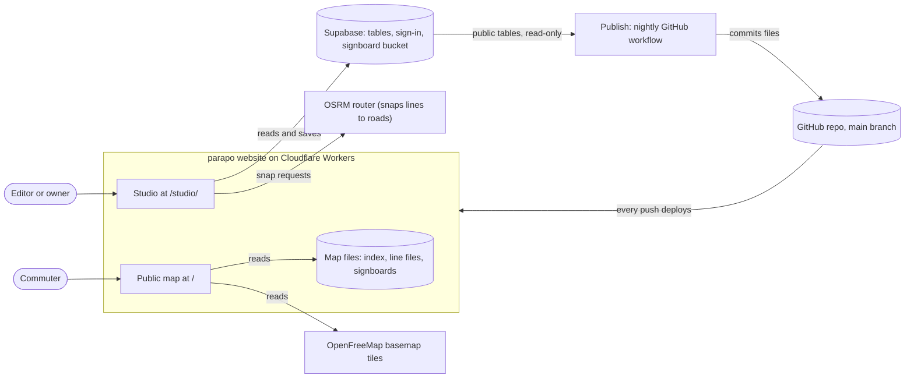
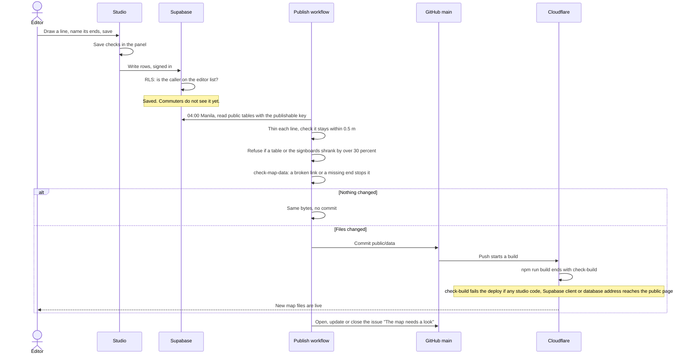
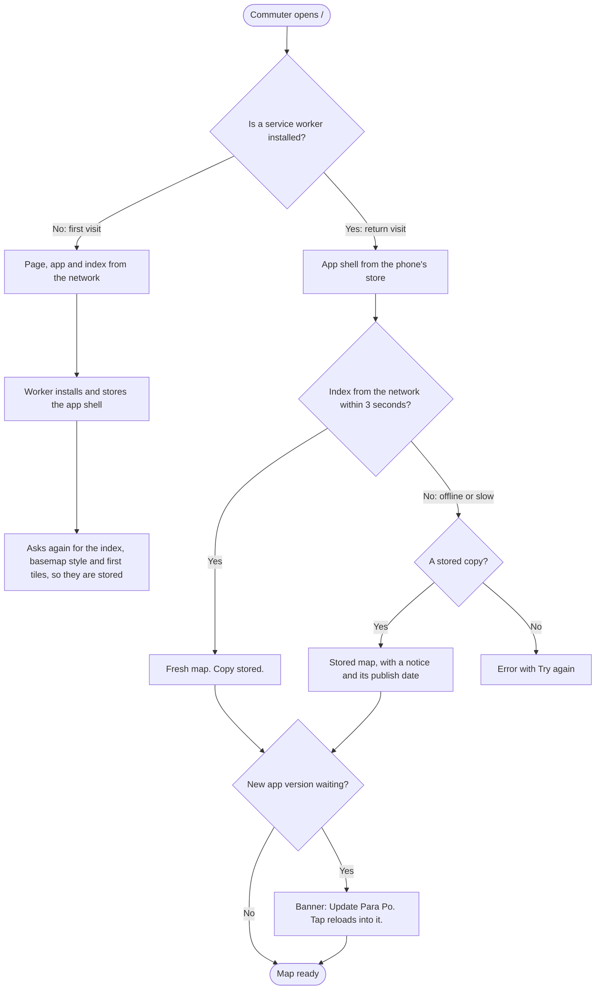

# System design

How data moves through ParaPo today, in five pictures. For the code's structure, see
[the code's structure, generated](architecture.md). The words follow [CONTEXT.md](../CONTEXT.md).

## 1. The whole system

Two apps share one website. Editors draw in the studio, which reads and writes the database.
Once a night, the publish turns the database into plain files. Commuters' phones read only those
files.

- The studio and the public map are two pages of one build, served from one place.
- The public map never talks to Supabase. Its only data is the map files (ADR 0001).
- The commuter's position stays on the phone. The locator never sends it to ParaPo or stores it.
  The map does move to it, so OpenFreeMap gets tile requests for that area, as for any map view.

## 2. From an edit to a live map

- A failed publish, or a data warning, opens one GitHub issue for the owner. The first clean run
  closes it.
- The owner can run the publish by hand. "Force" skips the shrink guard, for a deliberate clear-out.

## 3. The public map opening

What is cached where on the phone:

| Store                        | Holds                                 | Rule                                                    |
| ---------------------------- | ------------------------------------- | ------------------------------------------------------- |
| Precache                     | The public page's code, fonts, icons  | Replaced by a new version; never while the app is open  |
| `map-file`                   | The latest index                      | Network first, 3 s timeout, one copy                    |
| `map-lines`                  | Each line file ever opened            | Network first, 3 s timeout, up to 4,000                 |
| `signboards`                 | Signboard pictures                    | Cache first; each name is new when a board changes      |
| `basemap-meta`, `basemap-tiles` | Basemap style, fonts, tiles viewed | Up to 30 days each                                      |

- The index and line files are asked with `no-cache`: the server says "unchanged" cheaply.
- The worker checks for a new app version on each open and every hour. It never updates itself
  while open, so a ride on screen is never thrown away. The commuter taps the banner to update
  now; otherwise the new version starts on the next open, once every tab and app window has closed.
- When the phone runs out of space, the worker deletes four stores whole: `map-lines`,
  `signboards`, `basemap-meta` and `basemap-tiles`. The line files and signboards kept for
  offline use go too; only the index and the app itself stay.
- An index too new for an old app says so, and its Reload installs the newest app.
- The studio sits inside the worker's reach, but its pages and code always come from the network.
  When the worker controls a studio tab, the studio's basemap style and tiles are cached like the
  public map's.

## 4. Where each kind of data lives

| Data                                     | Owner   | Format                                | Who can read it                          |
| ---------------------------------------- | ------- | ------------------------------------- | ---------------------------------------- |
| Routes, directions, hotspots, links      | Studio  | Supabase tables                       | Anyone with the publishable key          |
| Control points and road segments         | Studio  | Columns on the direction table        | Anyone with the publishable key          |
| Signboards                               | Studio  | SVG files in a public bucket          | Anyone with the file's name              |
| Editor list                              | Owner   | `private.editor`, not exposed         | Nobody through the API                   |
| GPS traces (`gps_session`)               | Studio  | Table, unused today                   | The editor who recorded it               |
| Drawing draft                            | Studio  | The browser's local storage           | That browser only                        |
| Index, line files, signboard copies      | Publish | JSON and SVG in `public/data/`, in git | Everyone; served by Cloudflare          |
| Older indexes for installed apps         | Publish | `index.v3.json`, `index.json`, `map.json` | Everyone                            |
| Cached map, lines, tiles                 | Phone   | Service worker caches                 | That phone only                          |
| The commuter's position                  | Phone   | Memory only                           | That phone only; never sent to ParaPo or stored |

**RLS in a line:** anyone may read the public tables; only signed-in editors on the editor list
may write them; GPS traces are each editor's own.

## 5. Decisions

Recorded:

- [ADR 0001](adr/0001-visitors-read-a-published-file.md): commuters read published static files,
  never the database.
- [ADR 0002](adr/0002-route-names-are-generated-from-the-ends.md): a route's name is generated
  from its ends, with no override.

Made in the code, with no ADR yet (candidates):

- The map files live in git and deploy with the site. Git history is the archive of every
  published map.
- The index carries a shape number. A new shape gets a new file path, and the old one keeps
  being written for a month at least.
- The public page and the studio are one build. `check-build.mjs` proves the studio stays off
  the public page.
- Writes are locked to an editor list in the database (RLS), not by the studio's UI.
- The app never updates itself while open. The commuter taps to update.
- The publish refuses a sudden shrink, and fails loudly through one GitHub issue.
- The studio snaps lines with the public OSRM demo router.

## 6. Not yet built

- **Driver app:** drivers record their trips on their phones. See
  [`.scratch/driver-app/`](../.scratch/driver-app/spec.md).
- **Studio maps:** Drafts, Tracking and Public maps in the studio. See
  [`.scratch/studio-maps/`](../.scratch/studio-maps/spec.md).
- **Train tracking:** for LRT and MRT riders, on their own phones. See
  [`.scratch/train-tracking/`](../.scratch/train-tracking/spec.md).
